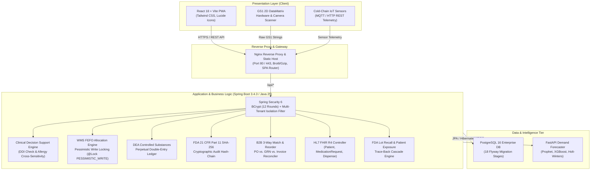

# MediStock Pro - Enterprise System Architecture & Compliance Guide

## 1. Executive System Overview

**MediStock Pro** is an enterprise-grade medical warehouse, hospital pharmacy management, and pharmaceutical supply chain platform. It is engineered from the ground up to comply with rigorous global healthcare standards:
* **FDA 21 CFR Part 11** (Electronic Records, Cryptographic Audit Trail Chaining)
* **DSCSA & GS1** (Drug Supply Chain Security Act, 2D DataMatrix Serialized Tracking)
* **DEA Schedules II–V** (Perpetual Controlled Substances Ledger & Witness Authentication)
* **WHO GDP Cold Chain** (IoT Real-Time Telemetry & Automated Excursion Quarantine)
* **HL7 FHIR R4** (Clinical & Pharmacy Interoperability Standard)

---

## 2. System Architecture



---

## 3. Regulatory Compliance Architecture

### 3.1 FDA 21 CFR Part 11: Cryptographic Audit Chaining
To ensure electronic records cannot be altered, retroactively edited, or deleted:
* **SHA-256 Hash Chaining:** Every audit entry computes its `signatureHash` using:
  $$\text{Hash}_n = \text{SHA-256}(\text{Hash}_{n-1} \parallel \text{Timestamp} \parallel \text{TenantId} \parallel \text{Action} \parallel \text{EntityType} \parallel \text{EntityId} \parallel \text{PayloadHash})$$
* **Genesis Block:** Initial seed starts at `GENESIS-BLOCK-HASH-0000000000000000`.
* **Tamper Verification:** Endpoint `/api/audit/verify-chain` verifies whether the sequence from genesis to head has any broken links or invalid hashes.

### 3.2 DSCSA & GS1 2D DataMatrix Tracking & Label Printing
The `Gs1BarcodeService` parses and verifies raw GS1 Application Identifiers conforming to international pharmaceutical standards:
* **(01)**: Global Trade Item Number (14-digit GTIN)
* **(17)**: Expiration Date (`YYMMDD` parsed to ISO Date)
* **(10)**: Batch / Lot Number (alphanumeric up to 20 chars)
* **(21)**: Serial Number (alphanumeric unique pack identifier)

**Interactive GS1 Label Generator:**
* Implemented in [`Gs1LabelModal.jsx`](file:///c:/Users/chira/Downloads/medistock-pro/src/components/Gs1LabelModal.jsx) and integrated directly into [`WarehouseScanner.jsx`](file:///c:/Users/chira/Downloads/medistock-pro/src/pages/WarehouseScanner.jsx) and [`Batches.jsx`](file:///c:/Users/chira/Downloads/medistock-pro/src/pages/Batches.jsx).
* Generates authentic 2D DataMatrix SVG barcodes with standard L-finder patterns and Code 128 1D bar strips.
* Supports **Standard 4" × 2" (Pallet/Carton)** and **Compact 2" × 1" (Unit-Dose Vial)** thermal presets.
* One-click print styling (`@media print`) compatible with Zebra ZT411, Honeywell PM43, and office laser printers.

### 3.3 DEA Controlled Substances Perpetual Ledger
Federal regulations mandate a continuous, real-time perpetual balance for Schedule II through V drugs:
* Every dispense, return, or waste action requires **two authenticated pharmacists/technicians** (witness sign-off).
* Prevents silent inventory leakage and logs waste destruction methods with witness signatures.

### 3.4 WHO Good Distribution Practices (Cold Chain)
* Ingests real-time IoT temperature and humidity readings via `/api/facility/cold-chain`.
* Safe biological storage standard: $+2.0^\circ\text{C}$ to $+8.0^\circ\text{C}$.
* If an excursion occurs ($T < 2.0^\circ\text{C}$ or $T > 8.0^\circ\text{C}$):
  1. The system flags an `EXCURSION` alert.
  2. The affected warehouse batch is **automatically transitioned to `QUARANTINED`** status.
  3. Dispense and picking allocations for that lot are blocked immediately.

---

## 4. Clinical Decision Support System (CDSS)

The `CdssService` evaluates patient safety before order verification or dispensing:

### Pairwise Drug-Drug Interactions (DDI) Matrix
| Drug Pair | Severity | Clinical Hazard | Action |
|:---|:---:|:---|:---|
| **Warfarin + NSAIDs** (e.g. Ibuprofen) | **CONTRAINDICATED** | High risk of major GI bleeding & INR instability | Blocks dispensing without explicit sign-off |
| **Opioids + Benzodiazepines** | **CRITICAL** | Profound sedation, respiratory depression, coma | Warning alert & mandatory justification |
| **Nitrates + PDE5 Inhibitors** | **CONTRAINDICATED** | Severe, potentially fatal refractory hypotension | Immediate prescription lock |
| **ACE Inhibitors + Spironolactone** | **WARNING** | Life-threatening hyperkalemia | Advisory & lab monitor recommendation |
| **Statins + Macrolides** | **WARNING** | CYP3A4 inhibition, rhabdomyolysis risk | Advisory alert |

### Allergy Cross-Sensitivity
* Scans patient known allergies against drug generic names and drug classes (e.g. Penicillins $\to$ Amoxicillin, Cephalosporins).
* If contraindicated, the pharmacist must provide a written, legally binding `overrideReason` recorded in the audit ledger.

---

## 5. B2B Procurement 3-Way Match & Autonomous Reorder

### 5.1 3-Way Reconciliation Protocol
Compares three core procurement documents:
1. **Purchase Order (PO):** Contracted quantity and agreed unit price.
2. **Goods Receipt Note (GRN):** Physically received and inspected quantity.
3. **Vendor Invoice:** Billed quantity and unit price.

**Tolerances:**
* Price Tolerance: $\pm 2.0\%$
* Quantity Tolerance: $0\%$ (no unreceived goods paid)
* Any mismatch generates a formal `InvoiceException` record (`PRICE_VARIANCE` or `QUANTITY_MISMATCH`) and halts payment authorization.

### 5.2 Autonomous Reorder & Stockout Prevention
The `ReorderService` runs automated burn rate velocity analytics:
* Evaluates 30-day consumption velocity ($V = \frac{\text{Units Sold}}{30\text{ days}}$).
* Calculates **Days of Inventory (DOI)**: $\text{DOI} = \frac{\text{Current Stock}}{V}$.
* Compares DOI against supplier lead time. If stock risks stockout within lead time + safety buffer, it automatically creates a draft `PurchaseRequest` with optimal EOQ batch sizing and converts to a vendor PO with one click.

---

## 6. HL7 FHIR R4 Interoperability & FDA Lot Recall

### 6.1 FHIR R4 RESTful APIs
* `GET /api/fhir/CapabilityStatement`: Exposes FHIR conformance profile.
* `GET /api/fhir/Patient/{id}`: Formats patient demographics and allergies into standard FHIR R4 JSON.
* `POST /api/fhir/MedicationRequest`: Ingests external e-prescriptions into hospital pharmacy workflows.
* `GET /api/fhir/MedicationDispense/{id}`: Exports FHIR-compliant dispense event records.

### 6.2 Emergency FDA Lot Recall Runbook
When a manufacturer or FDA issues a recall notice on a lot:
1. Dispatch `POST /api/recall/execute` with target `batchNumber`, `recallReason`, and `regulatoryAuthority` ("FDA" / "WHO").
2. The engine executes atomic operations:
   - Sets lot status to `RECALLED` across all warehouses and hospital pharmacy locations.
   - Blocks all future dispensing or transfers.
   - Executes backward trace-back query across historical `MedicationDispense` records.
   - Generates a **Patient Exposure Registry** listing all patients who received the recalled lot, their contact information, and dispensing dates for emergency outreach.

---

## 7. Multi-Tier Containerization & Quickstart

### 7.1 Multi-Tier Docker Deployment
The solution contains production-hardened Docker containers:
* **`frontend`**: Multi-stage Node 20 build $\to$ Nginx alpine production image.
* **`backend`**: OpenJDK 25 container with Spring Boot runnable jar.
* **`ml-service`**: Python 3.11 FastAPI microservice for AI forecasting.
* **`postgres`**: PostgreSQL 16 Alpine container with healthchecks.

### 7.2 Running Full Platform
```bash
# 1. Copy environment template
cp .env.example .env

# 2. Launch full-stack orchestration
docker compose up -d --build

# 3. Access Services
# Frontend Web App:     http://localhost:80
# Backend REST APIs:    http://localhost:8080/api
# Swagger OpenAPI:      http://localhost:8080/swagger-ui.html
# ML Demand Engine:     http://localhost:8000/docs
```

### 7.3 Offline System Verification
To verify the entire platform, run the unified verification script:
```bash
node scripts/verify_system.cjs
```
This script confirms:
1. Flyway migrations (V1 to V18)
2. Docker compose & Dockerfile configs
3. Frontend PWA bundle and service worker
4. Java 25 & Maven offline build
5. 25 of 25 unit/integration test suites passing (0 failures, 0 errors)

